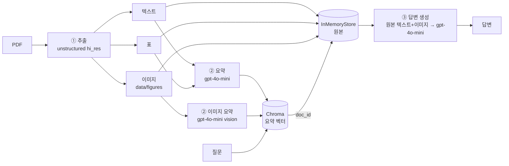

# 📊 경제상황 보고서 멀티모달 RAG

> 그래프와 표에만 있는 수치까지 답하는 RAG — PDF의 텍스트·표·이미지를 모두 요약해 검색합니다.

  

## 1. 문제 정의
- **문제 정의**: 은행 보조 자료 특성상 표와 이미지 파일이 많아 질문을 바로 찾아내기 어렵기 때문에 수치를 답한는 rag 를 사용해 검색을 목표로 한다.
- **자료**: [보도자료] 경제상황 평가(2026.10월) — <한국은행>, <18>쪽
- **자료 특성**: 핵심 수치(물가, 수출, 고용 등)가 본문보다 **그래프·표에** 들어 있음
- **문제**: 텍스트만 검색하는 RAG는 그래프에만 있는 수치를 물으면 "자료에 없다"고 답함
- **목표**: 이미지·표까지 검색 대상에 넣어, 그래프 속 수치로 답하게 만든다

| 추출 결과 | 개수 |
|---|---|
| 텍스트 청크 | 18 |
| 표 | 5 |
| 이미지 | 41 |
| 벡터DB 요약 수 | 64 |

## 2. 아키텍처


## 3. 왜 "요약으로 검색하고, 원본으로 답하나" (구조 이해)
- 이미지를 그대로 임베딩해서 질문과 비교하기가 어렵기 때문에 임베딩을 요약해 따로 저장한다.
- 요약은 짧고 검색 키워드가 담겨 있어 찾기 쉽다 
- 하지만 요약은 원본에 대한 자세한 정보가 빠지기 때문에 → 답할 때는 원본(그래프 이미지 자체)을 에이전트에 넘긴다
- 요약과 원본은 `doc_id`로 연결된다 (도서관의 색인 카드 ↔ 책)

## 4. 기술 선택 근거
| 항목 | 선택 | 이유 |
|---|---|---|
| 요약·답변 모델 | gpt-4o-mini | 이미지 입력 가능, 저렴하고 빠름 |
| 임베딩 | text-embedding-3-small |  |
| 청크 | 2000 토큰 / overlap 200 | <이유: 문맥 유지 vs 요약 비용> |
| 텍스트 프롬프트 | 한국어 | 원문이 한국어라 요약도 한국어여야 질문과 단어가 겹침 |
| 이미지 프롬프트 | 제목·수치·예상 질문·키워드 항목형 | 제목이 잘린 '산업별 취업자수' 그래프가 '만명'으로만 요약돼 검색에서 빠졌던 문제를 해결 |

## 5. 실행 방법
```bash
git clone <저장소 주소>
cd multimodal-rag
python -m venv .venv
.venv\Scripts\activate              # mac/linux: source .venv/bin/activate
pip install -r requirements.txt
copy .env.example .env              # .env 에 OPENAI_API_KEY 입력
```
그다음 `notebooks/Multi_modal_RAG.ipynb`를 위에서부터 실행합니다.
> 사전 설치: Poppler, Tesseract (PATH 등록)

## 6. Before / After


| | 텍스트 RAG | 멀티모달 RAG |
|---|---|---|
| 질문 | 24년말 대비 26년 1분기의 누적 평가이익을 알려줘 | 〃 |
| 답변 | "구체적인 수치는 제공되지 않았습니다" | "571조 원입니다" |
| 차이 원인 | 수치가 그래프에만 있어 텍스트 검색에 안 걸림 | 이미지 요약이 검색되고, 원본 그래프를 모델이 직접 읽음 |

## 7. 질의응답 5건
| # | 질문 | 답변 (요약) | 근거 원본 |
|---|---|---|---|
| 1 | 26년 3/4분기 제조업 취업자수는 전년 동기 대비 얼마나 변했어? | 전년 동기 대비 -5만 명 감소 | 이미지 (산업별 취업자수 그래프) |
| 2 | 24년말 대비 26년 1분기 누적 평가이익은 얼마야? | 948조 원에서 571조 원을 빼 377조 원이라고 답함 | 이미지 (누적 평가이익 그래프) |
| 3 | 2025년 소비자물가 상승률, 실업률은? | 소비자물가 2.3%, 실업률 2.8% | 표 (주요 경제지표) |
| 4 | 일시소득이 100만원 늘면 소비는 얼마나 늘어나? | 약 11만원 증가 (한계소비성향 약 0.113) | 텍스트 + 이미지 (소득·소비 그래프) |
| 5 | 민간소비 회복을 이끄는 요인 3가지는? | 반도체 경기 호조, 정부의 가계 이전 확대, 환율 하락 | 텍스트 + 이미지 (회복 여건 그래프) |

## 8. 폴더 구조
```
multimodal-rag/
├── data/            # 원본 PDF, figures/(Git 제외), processed/(Git 제외)
├── notebooks/       # Multi_modal_RAG.ipynb
├── src/
│   ├── extract.py   # PDF 추출·분류
│   ├── summarize.py # 텍스트·표·이미지 요약
│   └── retriever.py # 다중 벡터 저장, 결과 분리, 프롬프트 조립
├── .env.example
└── requirements.txt
```

## 9. 한계
- 로고·표지 이미지도 41장에 섞여 요약 비용이 낭비됨
- 이미지 요약 품질이 검색 성공을 좌우함 (제목이 잘린 그래프는 추정에 의존)
- InMemoryStore라 커널을 재시작하면 색인을 다시 만들어야 함
- 답변 수치는 모델이 그래프를 읽은 값이라 원본과 대조가 필요함

## 10. 보안
- `.env`는 `.gitignore`에 포함, 저장소에는 `.env.example`(키 없음)만 올림


